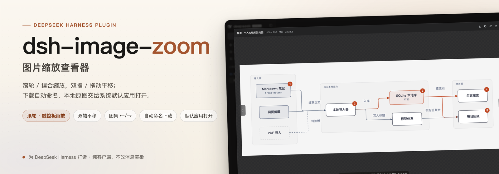
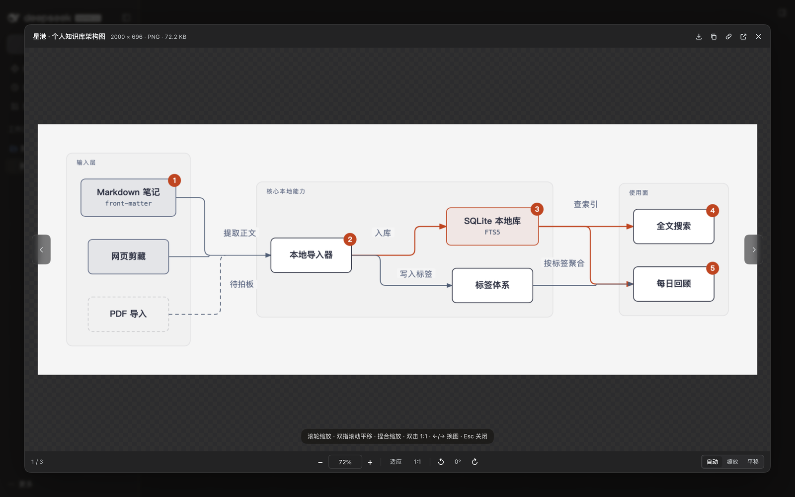
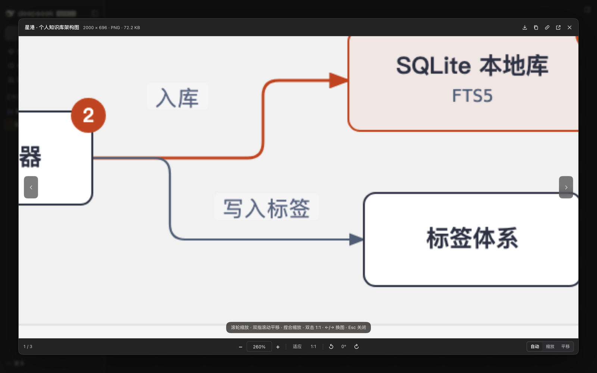
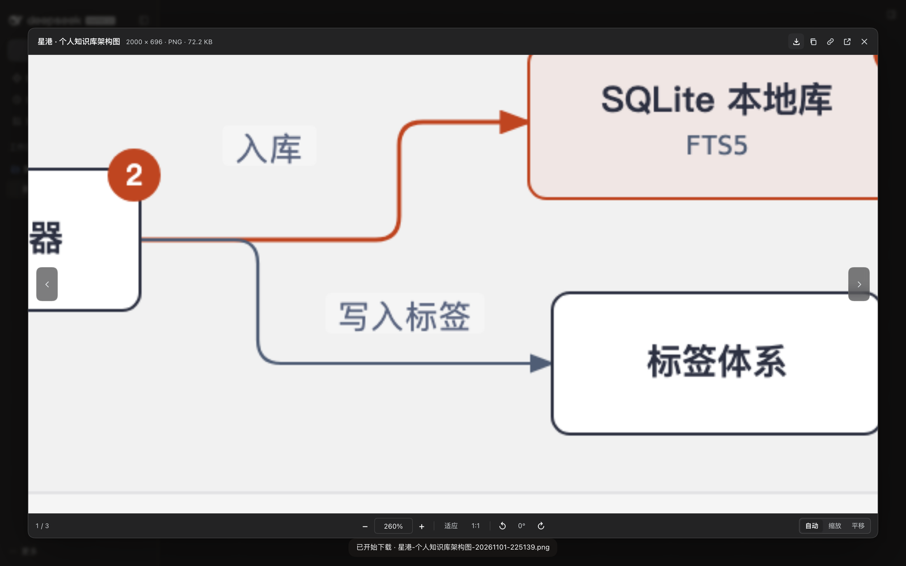
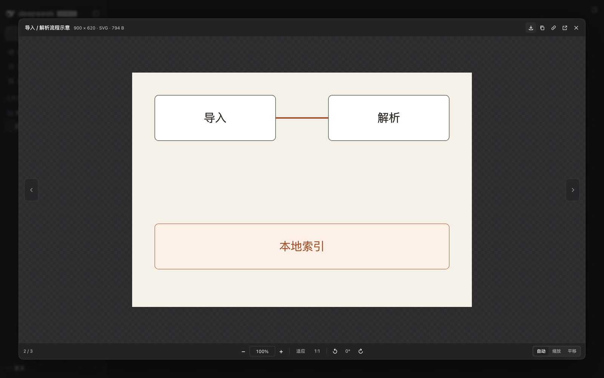

<p align="center">
  <a href="https://github.com/bingomu/dsh-image-zoom">
    
  </a>
</p>

# dsh-image-zoom

**A real image viewer for DeepSeek Harness.** Click any content image in chat — a Markdown image, a tool screenshot, a workspace artifact — and get wheel/pinch zoom, two-finger and drag panning, gallery browsing, and downloads that arrive with a sensible filename.

[](https://github.com/bingomu/dsh-image-zoom/releases)
[](https://github.com/deepseek-ai/deepseek-harness)
[](LICENSE)
[](https://github.com/bingomu/dsh-image-zoom/issues)
[](https://x.com/robinham)

English | [中文](README.zh.md)



## Why this plugin

The built-in image preview is a step up from a raw ``, but it is not a viewer: you cannot really zoom, pan on both axes, or keep a good filename when you save. `dsh-image-zoom` takes over content-image clicks and draws its own dialog:

| You want to… | How it works |
| --- | --- |
| Zoom with a mouse | Wheel zooms at the pointer. A normal notch (Windows 100 / Chrome 120) zooms immediately; a smooth-scroll or precise mouse with tiny deltas is confirmed as an isolated event after 75 ms and zooms too. |
| Zoom with a trackpad | Pinch (`ctrl`+wheel) zooms continuously. |
| Pan left/right and up/down | A two-finger scroll stream pans both axes; drag also pans; `Shift`+wheel pans sideways. |
| Read something small | Fit / 1:1 / double-click, `+`/`-`, typed percentage, 5%–4000%, rotate 90°. |
| Flip through screenshots | `←`/`→` or the side chevrons; `3 / 7` in the footer. |
| Keep the file | Download with a generated name, copy the image, copy an external image link, or open a workspace original in the system default app. |





## Install

**GitHub release tarball (current)**

```sh
dsh plugin --profile <your-profile> add https://github.com/bingomu/dsh-image-zoom/releases/latest/download/dsh-image-zoom-1.0.1.tgz
```

**Plugin market**

It is listed in the DSH plugin market (registry entry `awesome-dsh-plugin`) and installs with:

```sh
dsh plugin --profile <your-profile> add https://github.com/bingomu/dsh-image-zoom/releases/latest/download/dsh-image-zoom-1.0.1.tgz
```

**From a checkout (development)**

```sh
dsh plugin --profile <your-profile> add /path/to/dsh-image-zoom
```

Then restart DSH (or reload the page when only `client.js` changed). The plugin is client-only: it declares `dsh.bundle.patch` and a `dsh.client` web entry, and writes nothing to your sessions or files.

## Requirements

| Item | Value |
| --- | --- |
| DSH | `>=0.2.1-rc.2 <0.3.0-0` (declared in `engines.dsh`); developed and tested on DSH Desktop `0.2.1-rc.5` |
| Runtime | Web client / DSH Desktop. Node is only needed for tests. |
| Platform | macOS tested on the desktop app; Windows uses the same web client (the wheel notch path is covered by tests via synthetic 100/120 deltas). |

## Gestures and shortcuts

| Input | Action |
| --- | --- |
| Mouse wheel (one notch) | Zoom at the pointer |
| Pinch / `Ctrl`+wheel / `⌘`+wheel / `Alt`+wheel | Zoom |
| Two-finger scroll stream | Pan both axes |
| `Shift`+wheel | Pan sideways |
| Drag | Pan |
| `+` / `-` | Zoom 25% |
| `0` / `1` | Fit / actual size |
| Double-click | Fit ↔ 1:1 |
| `←` / `→` | Previous / next image |
| `Shift`+arrow keys | Pan 72 px |
| `R` / `Shift`+`R` | Rotate 90° clockwise / counter-clockwise |
| `Esc` | Close (first exits the zoom input) |

The footer has three explicit wheel modes — **Auto / Zoom / Pan** — stored in `localStorage`. Auto is explained above; choose *Zoom* if your mouse's smooth-scroll driver breaks the auto heuristic, or *Pan* if you want scroll to always move the picture.

### Download naming

Every download is saved as:

```text
<description>-<YYYYMMDD-HHmmss>.<ext>
```

- **description** = the image `alt` text, else a meaningful source filename, else the localized “image”.
- The local timestamp keeps names unique and sortable; the extension follows the detected format, so blob-backed screenshots never land as `.bin`.
- Characters Windows forbids are replaced, reserved device names get a trailing `_`, and long descriptions are capped at 48 characters.

The download button's tooltip previews the exact name; the macOS save dialog opens with it already filled in.

### Header actions

| Button | What it does |
| --- | --- |
| ↓ Download | Save the original with the name above |
| ⧉ Copy image | Copy to the clipboard as PNG/JPEG |
| 🔗 Copy link | Only for off-origin `http(s)` images: copy the absolute URL |
| ↗ Open original | Workspace images (served via `/api/file?path=…`) open in the **system default app** through the Host's `openWorkspacePath`; external images open in a new window; `blob:`/`data:` attachments explain that they have no local path |
| ✕ Close | Same as `Esc` |

## Feedback and support

- **Bugs and feature requests:** [GitHub Issues](https://github.com/bingomu/dsh-image-zoom/issues) — the primary channel; please use the templates and include DSH version, OS, and reproduction steps.
- **X / Twitter:** [@robinham](https://x.com/robinham) — short questions and release notes.
- **Questions and usage help:** [GitHub Discussions](https://github.com/bingomu/dsh-image-zoom/discussions) when enabled; otherwise open an issue.
- **Security reports:** do not open a public issue. See [SECURITY.md](SECURITY.md).
- **Response expectation:** this is a personally maintained project; issues are answered on a best-effort basis, usually within a week.

See [SUPPORT.md](SUPPORT.md) for the full support policy and [docs/identity-and-release.md](docs/identity-and-release.md) for the versioning and release policy.

## Versioning

- Semantic Versioning: patch for fixes, minor for backward-compatible features, major for breaking changes.
- Every release updates [CHANGELOG.md](CHANGELOG.md) and states its DSH compatibility in `engines.dsh`.
- A DSH release that drops compatibility is treated as a breaking change for this plugin.

## Development

```sh
npm run check          # node --check
./tests/chrome.sh      # headless Chrome with CDP on 127.0.0.1:9333
node tests/run-e2e.mjs # 88 assertions, real input events and real downloads
./tests/chrome.sh stop
```

The plugin is a single client entry (`client.js`) with no build step. Tests drive a minimal DSH-like harness over HTTP with wheel, pointer, keyboard, double-click and download behavior. See [tests/README.md](tests/README.md) for the isolation rules.

## License

MIT — see [LICENSE](LICENSE). Copyright © 2026 Genzo (bingomu).

---

<sub>Maintained by Genzo (@bingomu · @robinham). Not affiliated with DeepSeek. “DeepSeek Harness” is an open-source project by DeepSeek; this is a third-party plugin.</sub>
