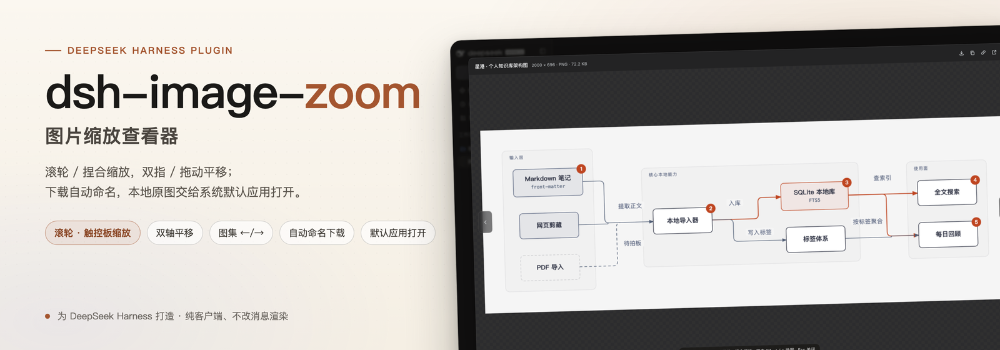
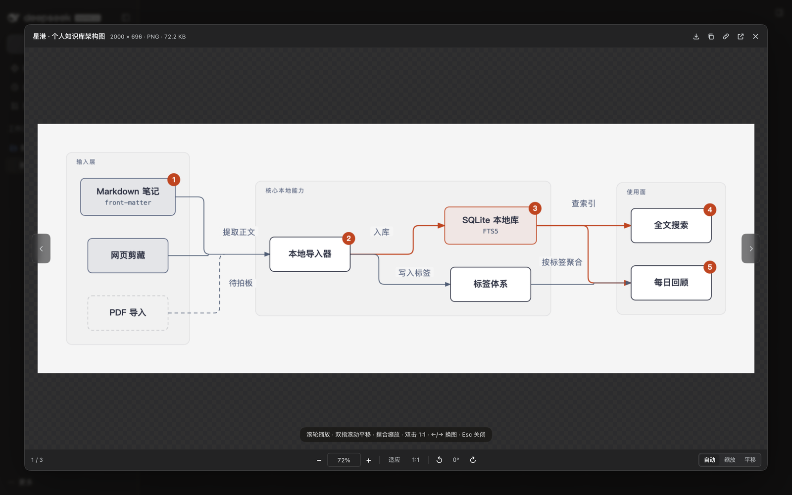
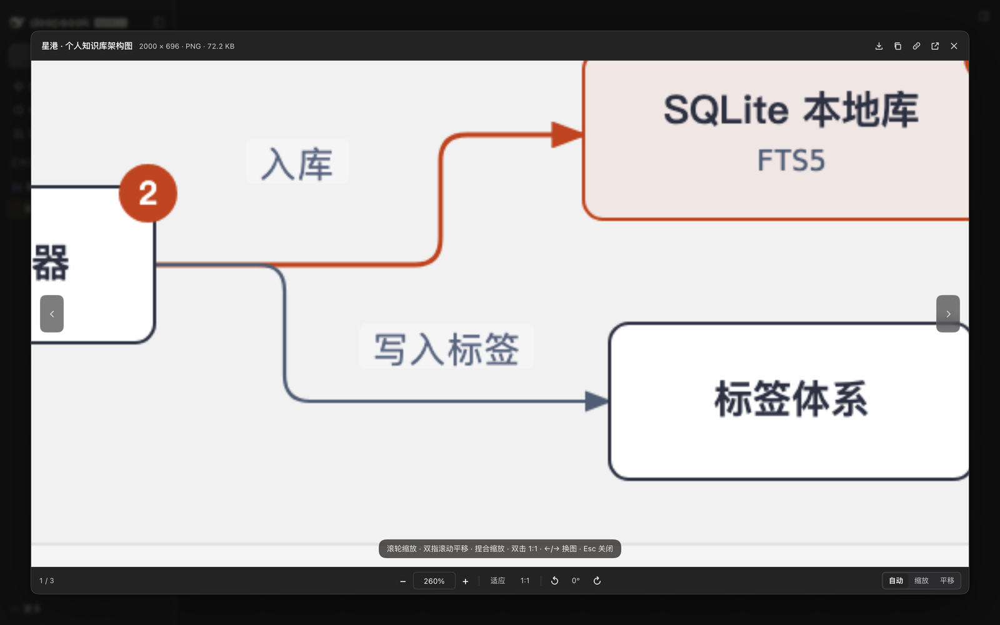
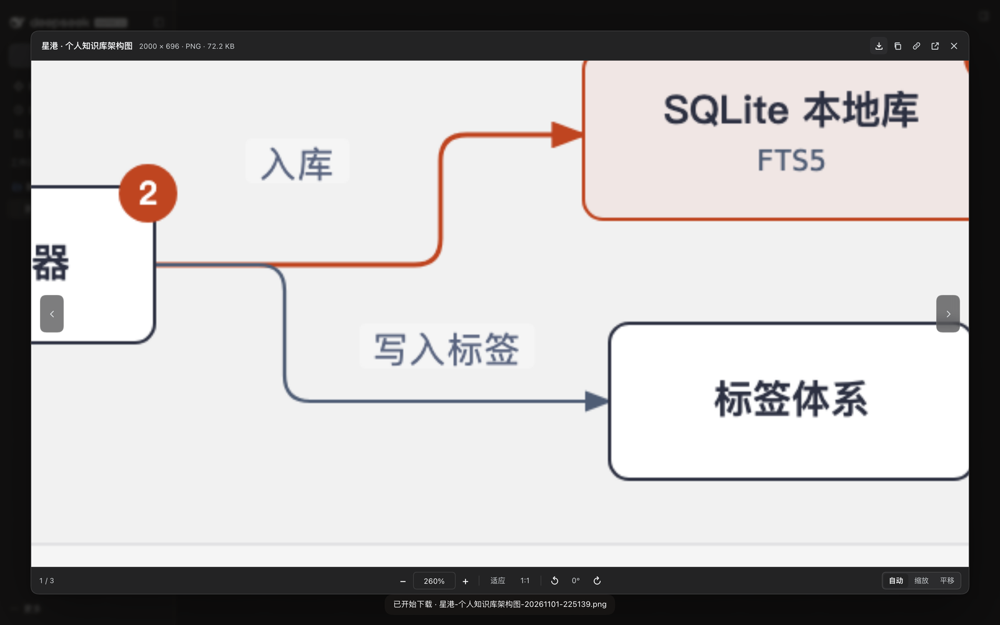
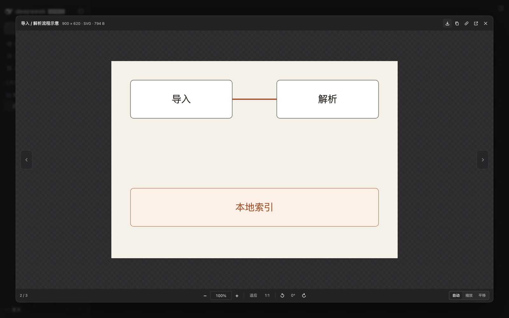

<p align="center">
  <a href="https://github.com/bingomu/dsh-image-zoom">
    
  </a>
</p>

# dsh-image-zoom

**给 DeepSeek Harness 的图片查看器。** 点开聊天里的任意图片（Markdown 图、工具截图、工作区产物），就能用滚轮 / 触控板捏合缩放、双指或拖动平移、左右切换图集，下载时还会自动带上一个像样的文件名。

[](https://github.com/bingomu/dsh-image-zoom/releases)
[](https://github.com/deepseek-ai/deepseek-harness)
[](LICENSE)
[](https://github.com/bingomu/dsh-image-zoom/issues)
[](https://x.com/robinham)

[English](README.md) | 中文



## 为什么装它

DSH 自带的图片预览解决了「能点开」，但还称不上查看器：不能真正缩放、不能双轴平移，保存下来的文件名也没法直接用。`dsh-image-zoom` 接管内容图片的点击，用自绘弹层替换预览：

| 你想做的事 | 它怎么做 |
| --- | --- |
| 用鼠标缩放 | 滚轮以指针为中心缩放。正常档位（Windows 100 / Chrome 120）立即缩；平滑滚动或精密鼠标的小 delta 会在 75ms 内确认为「孤立一下」后照样缩 |
| 用触控板缩放 | 双指捏合（`ctrl`+wheel）连续缩放 |
| 左右、上下滑动看图 | 触控板双指滚动是一串连续事件，按平移处理；也可以按住拖动；`Shift`+滚轮横向平移 |
| 看清小字 | 适应窗口 / 1:1 / 双击切换、`+`/`-`、可输入百分比、5%–4000%、旋转 90° |
| 多张截图来回看 | `←`/`→` 或两侧圆钮；底部 `3 / 7` |
| 把图拿走 | 下载（自动命名）、复制图片、复制外链、把工作区原图交给系统默认应用打开 |





## 安装

**GitHub Release tarball（当前）**

```sh
dsh plugin --profile <你的 profile> add https://github.com/bingomu/dsh-image-zoom/releases/latest/download/dsh-image-zoom-1.0.1.tgz
```

**DSH 插件市场**

已提交收录（`awesome-dsh-plugin`），市场里安装同样使用上面的 Release 地址。

**从源码安装（开发用）**

```sh
dsh plugin --profile <你的 profile> add /path/to/dsh-image-zoom
```

安装后重启 DSH；只改了 `client.js` 的话刷新页面（⌘R / Ctrl+R）即可。插件是纯客户端的：只声明 `dsh.bundle.patch` 和 `dsh.client` 的 Web 入口，不写会话、不写你的文件。

## 兼容性

| 项 | 值 |
| --- | --- |
| DSH | `>=0.2.1-rc.2 <0.3.0-0`（`engines.dsh`）；在 DSH Desktop `0.2.1-rc.5` 上开发与验证 |
| 运行环境 | Web 客户端 / DSH Desktop；Node 仅测试时需要 |
| 平台 | macOS 桌面端已实测；Windows 走同一套 Web 客户端（滚轮 100/120 档位由测试用合成事件覆盖） |

## 手势与快捷键

| 输入 | 行为 |
| --- | --- |
| 鼠标滚轮（单档） | 以指针为中心缩放 |
| 捏合 / `Ctrl`+滚轮 / `⌘`+滚轮 / `Alt`+滚轮 | 缩放 |
| 双指滚动（连续流） | 双轴平移 |
| `Shift`+滚轮 | 横向平移 |
| 按住拖动 | 平移 |
| `+` / `-` | 缩放 25% |
| `0` / `1` | 适应窗口 / 原始大小 |
| 双击 | 适应 ↔ 1:1 |
| `←` / `→` | 上一张 / 下一张 |
| `Shift`+方向键 | 平移 72px |
| `R` / `Shift`+`R` | 顺时针 / 逆时针旋转 90° |
| `Esc` | 关闭（输入框聚焦时先退出输入） |

底部有三档可见按钮 **自动 / 缩放 / 平移**，选择记在 `localStorage`。自动模式规则见上表；如果你的鼠标平滑滚动驱动把一次档位拆成小事件，选「缩放」即可；想让滚动永远平移就选「平移」。

### 下载命名规则

每次下载都保存为：

```text
<说明>-<YYYYMMDD-HHmmss>.<扩展名>
```

- **说明**：图片 `alt` → 有意义的源文件名 → 本地化的「图片」。
- 本地时间戳保证不重名、可排序；扩展名按识别到的真实格式，blob 截图不会变成 `.bin`。
- Windows 禁用字符替换、`CON`/`PRN`/`AUX` 等保留名加 `_`、超长说明截断到 48 字符。

下载按钮的 tooltip 会先显示本次文件名；macOS 保存对话框打开时已填好。

### 顶栏按钮

| 按钮 | 行为 |
| --- | --- |
| ↓ 下载原图 | 按上面的命名规则保存 |
| ⧉ 复制图片 | 写入剪贴板（PNG/JPEG） |
| 🔗 复制链接 | 仅对外链 `http(s)` 图片显示，复制绝对 URL |
| ↗ 打开原图 | 工作区原图（`/api/file?path=…`）通过 Host 的 `openWorkspacePath` 用**系统默认应用**打开；外链图开新窗口；`blob:`/`data:` 附件会说明没有本地路径 |
| ✕ 关闭 | 同 `Esc` |

## 反馈与支持

- **Bug 与功能请求**：[GitHub Issues](https://github.com/bingomu/dsh-image-zoom/issues) —— 主渠道，请用模板并附上 DSH 版本、系统、复现步骤。
- **X / 推特**：[@robinham](https://x.com/robinham) —— 简短问题与发版通知。
- **使用问题**：已启用 [GitHub Discussions](https://github.com/bingomu/dsh-image-zoom/discussions)，未启用时请开 Issue。
- **安全问题**：不要开公开 Issue，见 [SECURITY.md](SECURITY.md)。
- **响应预期**：个人维护项目，按尽力而为处理，通常一周内回复。

完整支持策略见 [SUPPORT.md](SUPPORT.md)，版本与发布策略见 [docs/identity-and-release.md](docs/identity-and-release.md)。

## 版本策略

- 语义化版本：补丁=修复，次版本=向后兼容的新功能，主版本=不兼容变更。
- 每次发版更新 [CHANGELOG.md](CHANGELOG.md)，并在 `engines.dsh` 里声明兼容的 DSH 范围。
- DSH 的更新如果让本插件不再兼容，按不兼容变更处理。

## 开发

```sh
npm run check          # node --check
./tests/chrome.sh      # 启动带 CDP 的 headless Chrome（127.0.0.1:9333）
node tests/run-e2e.mjs # 88 项断言：真实输入事件 + 真实下载
./tests/chrome.sh stop
```

插件是单个客户端入口（`client.js`），没有构建步骤。测试通过 HTTP 起一个最小 DSH 宿主，用真实滚轮 / 指针 / 键盘 / 双击与下载行为驱动。隔离注意事项见 [tests/README.md](tests/README.md)。

## 许可证

MIT，见 [LICENSE](LICENSE)。Copyright © 2026 Genzo (bingomu)。

---

<sub>由 Genzo（@bingomu · @robinham）维护。与 DeepSeek 无隶属关系。“DeepSeek Harness” 是 DeepSeek 的开源项目，本仓库是第三方插件。</sub>
